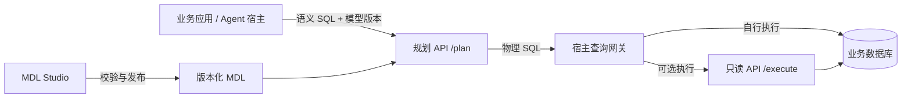
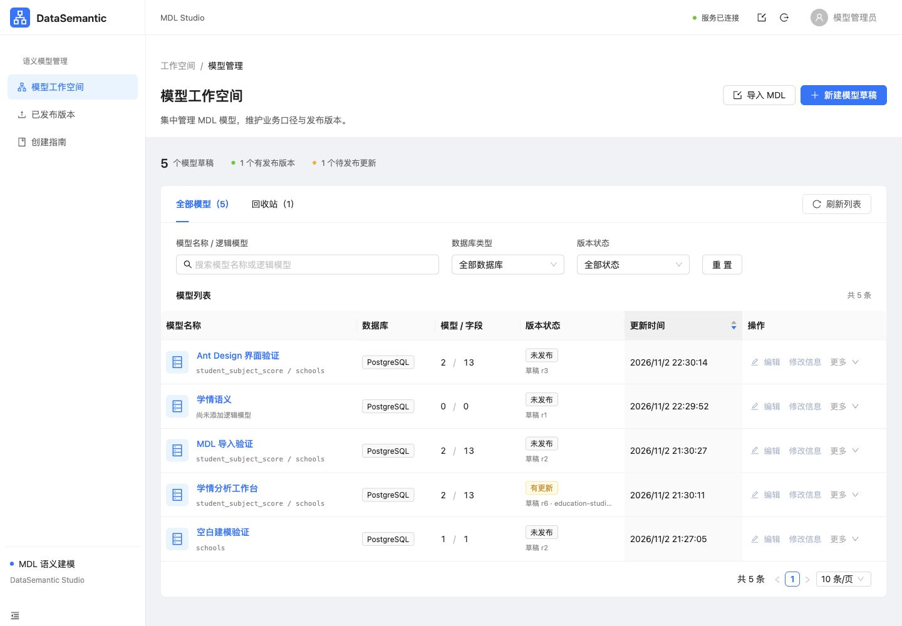
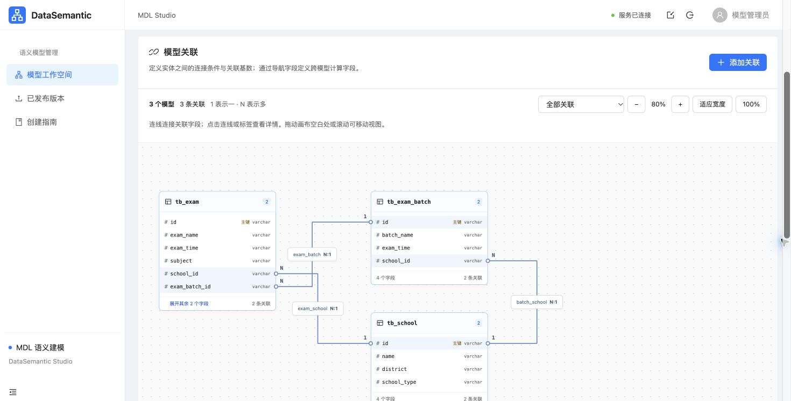

# DataSemantic

**面向业务应用与 AI Agent 的数据语义建模、SQL 规划与只读查询服务。**

DataSemantic 基于 WrenAI Core SDK，将数据库表、字段、关联与业务计算规则组织为可发布的语义模型，通过 HTTP API 将面向业务概念的语义 SQL 转换为目标数据库的物理 SQL。内置 MDL Studio 提供从数据库结构导入、可视化建模、SQL 校验到版本发布的完整工作流程。

应用可以围绕统一模型使用业务字段与计算口径，将底层表结构映射交给语义层处理。规划服务可独立运行，无需 LLM Key、向量数据库或业务库连接；需要查询结果时，可由宿主查询网关执行，也可启用本项目的只读执行接口。

[核心能力](#核心能力) · [快速开始](#快速开始) · [接口接入](#接口接入) · [使用与部署指南](docs/guide.md)

## 核心能力

| 能力 | 说明 |
| --- | --- |
| 语义 SQL 规划 | 基于已发布 MDL 展开逻辑模型、计算字段与关联，生成物理 SQL |
| 可视化建模 | 编辑模型、字段、主键、关联和语义视图，支持 JSON 导入与导出 |
| 自动建模 | 从 PostgreSQL、MySQL、DuckDB DDL 生成模型；支持直连 PostgreSQL、MySQL 扫描元数据 |
| 关联画布 | 展示字段连接与关系基数，支持缩放、平移和关联条件编辑 |
| 草稿与版本管理 | 工作空间搜索筛选、草稿修订检查、回收站、不可变版本发布与 ZIP 导出 |
| 规划校验 | 调用真实 Wren SDK 校验模型、预览物理 SQL，并测试语义视图能否成功规划 |
| 只读查询执行 | 可选接入 PostgreSQL、MySQL，限制查询类型、执行时间、返回行数与结果体积 |
| 服务集成 | Bearer 鉴权、模型 SHA-256 校验、模型上下文接口、健康检查与 OpenAPI 协议 |
| 进程隔离 | 规划、执行和元数据扫描使用独立子进程，支持并发限制与超时回收 |

### 数据库支持

| 数据库 | SQL 规划 | DDL 导入 | 元数据直连扫描 | 只读查询执行 |
| --- | --- | --- | --- | --- |
| PostgreSQL | ✓ | ✓ | ✓ | ✓ |
| MySQL | ✓ | ✓ | ✓ | ✓ |
| DuckDB | ✓ | ✓ | — | — |

具体 SQL 能力取决于模型、锁定的 SDK 版本及目标数据库方言，业务查询需在目标环境中验收。

## 工作原理

MDL（Modeling Definition Language）描述逻辑模型与物理数据之间的映射，包括字段类型、计算表达式、模型关联和语义视图。发布后，宿主通过模型 ID 与内容哈希固定查询所使用的版本。



例如，在模型中定义有效成绩字段：

```sql
CASE WHEN score_status = 'valid' THEN score ELSE NULL END
```

调用方即可使用统一业务字段计算均分：

```sql
SELECT school_id, AVG(valid_score) AS average_score
FROM student_subject_score
GROUP BY school_id
```

DataSemantic 根据 MDL 生成引用实际物理表与表达式的 SQL。该示例保留有效成绩中的真实零分，将其他状态排除在均分计算之外。

自然语言理解、语义 SQL 生成及最终用户授权由宿主应用负责；DataSemantic 提供建模、规划和可选执行能力。

## MDL Studio

Studio 采用 React、Ant Design 5 与 ProLayout，提供中文建模界面。前端资源随服务本地提供，运行时无需 CDN。

### 工作空间管理

集中管理模型草稿，按名称、数据库类型与发布状态查找工作空间，支持模型更新、删除和恢复。



### 关联建模

通过画布查看模型间的字段关联与基数，并结合字段编辑器、语义视图和 JSON 源码维护模型定义。



典型建模流程：

1. 从数据库扫描、DDL、MDL JSON 或内置模板创建草稿。
2. 选择建模范围，配置字段、计算表达式、主键与关联。
3. 添加语义视图，维护可复用的业务查询逻辑。
4. 保存并校验模型，预览生成的物理 SQL。
5. 发布唯一版本，交由宿主审核并绑定使用。

数据库扫描仅读取结构元数据；DDL 导入仅解析表结构。Studio 中的 SQL 预览与“测试视图”执行规划校验，不执行业务查询。自动建模依据明确外键生成关联，业务指标口径仍需人工补充和确认。

## 快速开始

### Docker 部署

准备 Docker 和 Docker Compose，以及用于初始化凭据的 Python 3。在仓库根目录执行：

```bash
python3 scripts/init_env.py
docker compose up -d --build --wait
curl http://127.0.0.1:8090/health/ready
```

初始化脚本仅在 `.env` 不存在时创建随机服务令牌，文件权限为 `0600`，不会覆盖已有配置或打印令牌。就绪接口返回 `status: ready` 表示模型已完成启动校验。

默认服务地址为 `http://127.0.0.1:8090`，Compose 仅绑定本机端口。镜像以非 root 身份运行，模型目录只读挂载，Studio 数据保存在 `studio-data` 命名卷中。

### 启用 Studio

Studio 默认关闭。在 `.env` 中添加以下配置，将密码占位内容替换为至少 12 字符、且与服务令牌不同的独立管理密码：

```dotenv
WREN_STUDIO_ENABLED=true
WREN_STUDIO_PASSWORD=replace-with-your-admin-password
```

重新应用配置：

```bash
docker compose up -d --build --wait
```

访问 [MDL Studio](http://127.0.0.1:8090/studio/)，使用管理密码登录。HTTPS 部署应设置 `WREN_STUDIO_COOKIE_SECURE=true`，反向代理需正确转发协议与 Host，保持管理请求同源。

### 本地开发

后端需要 Python 3.11～3.13 和 uv；修改前端需要 Node.js 22。仓库附带前端构建产物，可直接启动 Python 服务。

```bash
python3 scripts/init_env.py
uv sync --locked --python 3.11
uv run --locked uvicorn wren_semantic.app:create_app --factory \
  --host 127.0.0.1 --port 8090 --workers 1 --env-file .env --no-access-log
```

另开终端运行 HTTP 冒烟验证：

```bash
uv run --locked python scripts/smoke_http.py
```

脚本使用随附演示模型，验证健康检查、鉴权、SQL 规划及错误处理，不连接业务数据库。

## 接口接入

所有 `/internal/v1/*` 接口均需要 `Authorization: Bearer <WREN_SERVICE_TOKEN>`。健康检查无需鉴权；Studio 使用独立管理会话。

| 方法 | 路径 | 用途 |
| --- | --- | --- |
| GET | `/health/live` | 进程存活检查 |
| GET | `/health/ready` | 模型加载与规划就绪检查 |
| GET | `/internal/v1/bundles` | 获取模型版本、SHA-256 与数据库方言 |
| GET | `/internal/v1/bundles/{bundle_id}/context` | 获取逻辑模型、字段及关联上下文 |
| POST | `/internal/v1/plan` | 将语义 SQL 转换为物理 SQL |
| POST | `/internal/v1/execute` | 在注册数据源上执行只读物理 SQL |
| GET | `/internal/v1/openapi.json` | 获取 OpenAPI 协议 |

以下示例在仓库根目录通过 `uv run --locked python` 运行。它读取本地 `.env`，获取演示模型的当前哈希，并发起一次规划请求：

```python
import os

import httpx
from dotenv import load_dotenv

load_dotenv(".env")

with httpx.Client(
    base_url=os.getenv("WREN_BASE_URL", "http://127.0.0.1:8090"),
    headers={"Authorization": f"Bearer {os.environ['WREN_SERVICE_TOKEN']}"},
    timeout=20,
) as client:
    response = client.get("/internal/v1/bundles")
    response.raise_for_status()
    bundle = next(
        item for item in response.json()["bundles"]
        if item["bundle_id"] == "education-demo-v1"
    )

    response = client.post(
        "/internal/v1/plan",
        json={
            "bundle_id": bundle["bundle_id"],
            "manifest_hash": bundle["manifest_hash"],
            "semantic_sql": "SELECT AVG(valid_score) FROM student_subject_score",
        },
    )
    response.raise_for_status()
    print(response.json()["physical_sql"])
```

正式接入时，宿主应固定经过审核的 `bundle_id + manifest_hash`。哈希不一致会返回 `409 MODEL_VERSION_MISMATCH`，需重新审核版本绑定。

只读执行默认关闭。启用时需配置服务端数据源、数据库只读账号及密码环境变量，详见[执行物理 SQL](docs/guide.md#执行物理-sql)。

## 配置概览

| 环境变量 | 默认值 | 说明 |
| --- | --- | --- |
| `WREN_SERVICE_TOKEN` | 必填 | 服务令牌，至少 32 字符 |
| `WREN_REGISTRY_PATH` | `models/registry.json` | 模型发布清单；Compose 中为 `/models/registry.json` |
| `WREN_PLAN_TIMEOUT_SECONDS` | `15` | 单次规划超时，单位为秒 |
| `WREN_MAX_CONCURRENT_PLANS` | `2` | 每个 API worker 的规划并发上限 |
| `WREN_STUDIO_ENABLED` | `false` | 启用 MDL Studio |
| `WREN_STUDIO_PASSWORD` | 未设置 | Studio 独立管理密码，至少 12 字符 |
| `WREN_STUDIO_DATA_DIR` | `.state/studio` | 本地 Studio 数据目录；Compose 中为 `/state/studio` |
| `WREN_EXECUTION_SOURCES_PATH` | 未设置 | 执行数据源配置路径；未设置时关闭执行 |
| `WREN_EXECUTION_TIMEOUT_SECONDS` | `15` | 单次执行超时，单位为秒 |
| `WREN_HTTP_PORT` | `8090` | Compose 映射的本机端口 |

更多配置见 [`.env.example`](.env.example) 与[配置和错误处理](docs/guide.md#配置与错误)。

## 接入边界

服务令牌代表受信任的宿主后端，宿主负责最终用户身份、工作空间与数据源授权，以及查询结果的行列权限。执行接口不会校验 MDL 或模型版本，服务令牌可访问全部已注册执行源。

规划与执行均限制为只读查询，并实施请求大小、并发与超时限制。数据库执行仍应使用最小权限只读账号；业务应用需在服务端保管令牌并落实用户权限。

随附 `education-demo-v1` 用于演示语义建模与规划，其中的物理表映射不代表已部署的业务数据库。业务口径、实际表结构和查询结果需在接入时核验。模型发布与校验方式见[模型发布](docs/guide.md#模型发布)。

## 技术栈与目录

后端使用 FastAPI、Pydantic Settings、SQLGlot 与 WrenAI Core SDK；前端使用 React 18、Ant Design 5、ProLayout 与 esbuild；Studio 使用 SQLite 持久化草稿、发布版本及管理会话。

当前项目版本为 `0.1.0`，锁定 `wrenai==0.17.1` 与底层 `wren-core-py==0.8.2`，完整依赖见 [`uv.lock`](uv.lock)。

```text
DataSemantic/
├── src/wren_semantic/       # HTTP 服务、规划、执行与建模逻辑
│   └── static/             # Studio 静态资源与前端构建产物
├── frontend/               # React 界面与构建脚本
├── models/                 # MDL 发布清单与演示模型
├── config/                 # 执行数据源配置示例
├── scripts/                # 环境初始化与 HTTP 冒烟验证
├── tests/                  # 后端测试与数据库集成测试
├── docs/                   # 使用与部署指南
├── artifacts/              # 界面截图、业务建模资料与展示素材
├── compose.yaml            # 默认容器部署配置
└── compose.execution.example.yaml
```

## 开发验证

后端检查：

```bash
uv run --locked ruff check .
uv run --locked ruff format --check .
uv run --locked pytest -q
```

前端检查与构建，在 `frontend` 目录执行：

```bash
npm ci
npm run check
npm test
npm run build
```

前端修改后需同步更新 `src/wren_semantic/static/` 下的构建产物。Docker 构建会自动重建前端。真实数据库集成测试需要独立测试库并显式启用，具体要求见[验证说明](docs/guide.md#验证)。

## 进一步阅读

- [使用与部署指南](docs/guide.md)：Studio 操作、数据源配置、模型发布、接口契约与错误处理。
- [模型发布清单](models/registry.json)与[演示 MDL](models/education-demo-v1/mdl.json)：了解模型版本与文件结构。
- [执行数据源配置示例](config/execution-sources.example.json)：配置 PostgreSQL 或 MySQL 只读执行。
- [WrenAI 上游项目](https://github.com/Canner/WrenAI)：本项目所使用的 SDK 来源。DataSemantic 的 HTTP 接口、Studio 与发布协议由本仓库实现。
