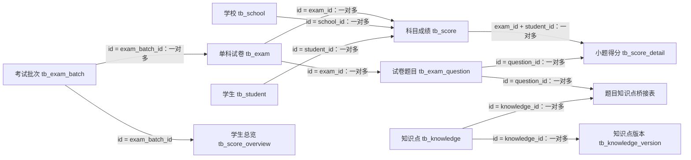

# 学情分析数据库字段关联关系

日期：2026-11-03。依据此前扫描得到的18张表字段快照，以及awesome-project的配置、DDL参考、导入与查询代码。**本次没有实时查询数据库系统目录；下面区分代码已使用的关系、字段注释支持的关系和待验证推断。基数均是业务预期，不表示物理外键已存在。**

**先记住主链：考试批次 → 单科试卷 → 学生科目成绩 → 学生小题得分；学校和学生是维度；题目通过桥接表关联多个知识点。**

## 1. 18张表的角色和一行代表什么

| 表 | 中文含义 | 一行的业务粒度 | 扫描MDL中的主键 |
|---|---|---|---|
| `tb_assign_band` | 再选科目赋分档 | 考试×科目×等级 | `id` |
| `tb_elite_class` | 尖子班名单 | 考试×学校×班级×方向 | `id` |
| `tb_exam` | 单科试卷 | 该批次下的一份单科试卷 | `id` |
| `tb_exam_batch` | 考试批次 | 一场考试批次 | `id` |
| `tb_exam_match_item` | 匹配任务题目结果 | 一次任务中的一道题结果（推断） | `id` |
| `tb_exam_match_task` | 知识点匹配任务 | 一次匹配任务（推断） | `id` |
| `tb_exam_question` | 试卷题目 | 一份试卷的一道题 | `id` |
| `tb_exam_question_knowledge` | 题目—知识点关联 | 一道题×一个知识点 | `参考DDL为(question_id,knowledge_id)复合主键` |
| `tb_fraction_bar` | 预测分数线 | 一场考试的各方向分数线配置（业务预期） | `id` |
| `tb_knowledge` | 知识点 | 一个知识点身份 | `id` |
| `tb_knowledge_version` | 知识点版本 | 一个知识点的一次版本快照 | `id` |
| `tb_school` | 学校 | 一所学校/校区 | `id` |
| `tb_score` | 学生科目成绩 | 一名学生×一份试卷 | `id` |
| `tb_score_contribution` | 切线贡献分 | 考试×方向×线种（依字段含义推导） | `id` |
| `tb_score_detail` | 学生小题得分 | 一名学生×一份试卷×一个题号 | `id` |
| `tb_score_indicator` | 学校达线汇总 | 考试×学校×方向×线种 | `id` |
| `tb_score_overview` | 学生考试总览 | 一名学生×一场考试（业务预期） | `id` |
| `tb_student` | 学生 | 一个学生标识 | `id` |

复合主键说明：此前自动扫描的MDL没有给题目知识点桥接表生成单字段primaryKey，这不等于数据库没有主键。参考DDL定义的是两个字段组成的主键，而当前Studio的模型primaryKey只接受一个字段。不要把question_id单独标为唯一主键。

## 2. 核心关系图

箭头表示预期业务关系；虚线/实线仅用于阅读，不能用来判定数据库真实外键或强制非空。



“一对多”例如：一份数学试卷有很多学生成绩，但每条成绩只属于一份试卷。在Studio从成绩表连向试卷表时，选择MANY_TO_ONE。

## 3. 可优先配置的核心关系

下列都按“左表多行 → 右表一行”书写。配置成MANY_TO_ONE前，右表匹配键必须唯一。

| 编号 | 左表字段 → 右表字段 | 用途/注意 | 证据级别 |
|---|---|---|---|
| R01 | `tb_exam.exam_batch_id` → `tb_exam_batch.id` | 一场考试批次包含多份单科试卷。  | 字段与代码支持 |
| R02 | `tb_score.exam_id` → `tb_exam.id` | 把学生成绩关联到对应单科试卷，取得科目与卷面满分。  | 字段与代码支持 |
| R03 | `tb_score.student_id` → `tb_student.id` | 同一学生在多份试卷中有多条成绩。 tb_student主键叫id，不叫student_id。 | 字段与代码支持 |
| R04 | `tb_score.school_id` → `tb_school.id` | 确定该次成绩所属学校。 历史考试学校以成绩记录为准。 | 字段与代码支持 |
| R05 | `tb_student.school_id` → `tb_school.id` | 学生维度记录的学校归属。 可能是当前/最近更新的学校，不应覆盖历史成绩学校。 | 字段结构支持 |
| R06 | `tb_score_detail.exam_id` → `tb_exam.id` | 小题得分所属单科试卷。  | 字段与代码支持 |
| R07 | `tb_score_detail.student_id` → `tb_student.id` | 小题得分属于哪位学生。  | 字段结构支持 |
| R08 | `tb_score_detail.exam_id` → `tb_score.exam_id`<br>`tb_score_detail.student_id` → `tb_score.student_id` | 同一学生同一份卷有多条小题得分。 必须两个条件同时匹配；右表(exam_id,student_id)应唯一。 | 字段与代码支持 |
| R09 | `tb_exam_question.exam_id` → `tb_exam.id` | 一份单科试卷包含多道题。  | 字段与代码支持 |
| R10 | `tb_score_detail.question_id` → `tb_exam_question.id` | 取得这道题的题型、题干和满分。 同时核对detail.exam_id=question.exam_id；旧查询容忍question.exam_id为空，但新配置应优先保证一致。 | 字段与代码支持 |
| R11 | `tb_exam_question_knowledge.question_id` → `tb_exam_question.id` | 题目知识点桥接表的题目端。  | 字段与代码支持 |
| R12 | `tb_exam_question_knowledge.knowledge_id` → `tb_knowledge.id` | 题目知识点桥接表的知识点端。 题目↔知识点整体为多对多；weight用于题内权重归一化。 | 字段与代码支持 |
| R13 | `tb_knowledge_version.knowledge_id` → `tb_knowledge.id` | 一个知识点有多条内容版本历史。 当前eqk关联知识点身份ID，没有version_id；不能声称某次考试自动锁定知识点历史版本。 | 扫描字段注释支持 |
| R14 | `tb_score_overview.exam_batch_id` → `tb_exam_batch.id` | 学生某次考试总览对应考试批次。 老代码也会按exam_name=batch_name关联；ID应优先。 | 字段与代码支持 |
| R15 | `tb_score_overview.anon_stu_id` → `tb_student.id` | 总览匿名学生标识与学生维度对齐。 需检查历史数据是否使用同一匿名编码算法；换校可能改变匿名ID。 | 导入逻辑支持 |
| R16 | `tb_fraction_bar.exam_batch_id` → `tb_exam_batch.id` | 考试批次对应预测线配置。 业务期望每批次一行，但参考DDL未对exam_batch_id设唯一约束；未检查真实唯一性。 | 字段与代码支持 |
| R17 | `tb_score_indicator.exam_batch_id` → `tb_exam_batch.id` | 学校×选科方向×线种达线汇总所属批次。  | 字段与代码支持 |
| R18 | `tb_score_contribution.exam_batch_id` → `tb_exam_batch.id` | 方向×线种切线贡献分所属批次。 主要教研代码会从overview重算贡献分；此表存在不等于查询必然读取它。 | 扫描字段注释支持 |
| R19 | `tb_assign_band.exam_batch_id` → `tb_exam_batch.id` | 某次考试再选科目ABCDE分档。  | 字段与代码支持 |
| R20 | `tb_elite_class.exam_batch_id` → `tb_exam_batch.id` | 某次考试的尖子班配置。  | 字段与代码支持 |
| R21 | `tb_exam_match_task.exam_id` → `tb_exam.id` | 一份试卷可有多次知识点匹配任务。 原项目主查询中未发现相应任务表实现，需实际DDL/任务服务确认。 | 扫描字段结构推断 |
| R22 | `tb_exam_match_task.question_id` → `tb_exam_question.id` | 任务针对指定题目时关联该题。 仅适用于指定题目任务；全卷任务的question_id可能为空，且需核对scope含义和试卷一致。 | 扫描字段结构推断 |
| R23 | `tb_exam_match_item.task_id` → `tb_exam_match_task.id` | 一个匹配任务包含多个题目处理结果。 待实际DDL/任务服务确认。 | 扫描字段结构推断 |
| R24 | `tb_exam_match_item.question_id` → `tb_exam_question.id` | 匹配结果对应具体题目。 current_links/add_suggestions/remove_suggestions是结果快照，不可当作已经生效的eqk关联行。 | 扫描字段结构推断 |
| R25 | `tb_exam.school_id` → `tb_school.id` | 学校自建试卷的归属学校。 全市统考试卷的school_id允许为空；不等于每位考生所在学校。 | 扫描字段注释支持 |
| R26 | `tb_exam_batch.school_id` → `tb_school.id` | 学校自建考试批次的归属学校。 全市考试可为空；exam_type、owner_id的使用需按创建考试的业务核对。 | 扫描字段结构推断 |

## 4. 有条件的关联：不能只凭同名字段连接

| 编号 | 候选关联 | 需要同时满足什么 |
|---|---|---|
| R27 | `tb_score_overview.xx = tb_school.s_name` | 最新导入保存原始XX文字；应核对编码前缀、校区名、空白和名称唯一性。禁止直接xx=tb_school.id。 |
| R28 | `tb_score_indicator.school_name = tb_school.s_name` | 代码实际ON ind.school_name=COALESCE(sch.s_name,sch.name)。indicator.school_id可能同样存学校名，不能直接与sch.id等同。 |
| R29 | `tb_score_indicator.exam_batch_id = tb_score_overview.exam_batch_id AND tb_score_indicator.school_id = tb_score_overview.xx` | 必须增加由overview.xkkm归一化得到的track=indicator.track；全线种范围内为多对多，单个学生对应多条线，单条汇总对应多个学生。推荐在专用视图中处理，禁止直接累计学生分。 |
| R30 | `tb_score_contribution.exam_batch_id = tb_score_indicator.exam_batch_id AND tb_score_contribution.track = tb_score_indicator.track AND tb_score_contribution.line_code = tb_score_indicator.line_code` | 两侧先过滤相同批次，确认线种唯一及阈值版本；NULL批次旧数据不能直接丢弃或擅自跨场匹配。 |
| R31 | `tb_elite_class.exam_batch_id = tb_score_overview.exam_batch_id AND tb_elite_class.school_id = tb_score_overview.xx AND tb_elite_class.class_name = tb_score_overview.bj` | 如配置指定track，还需和xkkm归一方向匹配；school_id在此按xx语义存值，需确认是名称。 |
| R32 | `tb_fraction_bar.exam_batch_id = tb_score_overview.exam_batch_id` | 保证分数线配置每批次唯一，再按学生方向选wl或ls列；不能把各方向所有线阈值混用。 |
| R33 | `tb_score.student_id = tb_score_overview.anon_stu_id` | 必须经tb_exam取exam_batch_id，再加overview.exam_batch_id=exam.exam_batch_id；旧代码使用overview.exam_name=COALESCE(batch_name,paper_name)。不能只关联学生。 |
| R34 | `tb_assign_band.exam_batch_id = tb_exam.exam_batch_id AND tb_assign_band.subject = tb_exam.subject` | 并非字段声明外键；同批次同科有多卷时不唯一。更常用来解释overview等级，见下文。 |

## 5. 最容易接错的字段

### 5.1 exam_id是试卷，不是整场考试

`tb_score.exam_id → tb_exam.id`；再用`tb_exam.exam_batch_id → tb_exam_batch.id`。不要直接把score.exam_id关联batch.id，即使两个值偶然相等。

### 5.2 学校名称和学校ID是两套东西

| 字段 | 当前代码/扫描中的含义 | 配置办法 |
|---|---|---|
| tb_school.id | 学校标识 | score.school_id、student.school_id可按ID关联 |
| tb_school.name | 脱敏/密文学校名 | 不直接与明文名称相等 |
| tb_school.s_name | 明文学校名 | 与总览XX映射时的候选字段，先检查唯一性 |
| tb_score_overview.xx | 最新导入保留原始学校文字，可能含A01等前缀/校区名 | 名称规范后映射；不要直接等于school.id |
| tb_score_indicator.school_id | 注释旧称校码，但重算代码会把overview学校文字写进去 | 不能按列名断定它是school.id；核对实际值 |
| tb_score_indicator.school_name | 达线学校展示名 | 原查询按COALESCE(s_name,name)映射学校 |
| tb_elite_class.school_id | 设计按overview.xx对齐 | 先核对存储语义，再加班级、考试、方向条件 |
| tb_score_overview.xh | 原文件字段，注释/导入说明存在差异 | 不把它猜成school.id或student.id的通用关联键 |

可从总览经`anon_stu_id → student.id → student.school_id → school.id`定位学生当前学校，但这条路径不保证是考试当时学校，转校时会改变历史归属。正式建模更适合补明确的历史school_id映射。

### 5.3 班级名称不是全库唯一

全市很多学校都有高三(1)班。成绩班级为`tb_score.class`，总览为`tb_score_overview.bj`，尖子班配置为`tb_elite_class.class_name`。跨表匹配班级通常至少带学校与考试；本库18表没有独立班级维度表。

### 5.4 小题题号必须带试卷

优先`detail.question_id=question.id`；缺question_id时的候选关系是`detail.exam_id=question.exam_id AND detail.question_no=question.question_no`，须验证(试卷,题号)唯一。不能只按题号：不同科目都有第1题。题号是字符串，可以是24-1、单选1、语法填空等，不能强制全部转整数。

### 5.5 同一学生会出现在很多场考试

科目成绩与总览除了学生ID还要匹配当前考试批次。总览原始导入UPSERT使用(ksh,exam_name)，不保证(anon_stu_id,exam_batch_id)已经唯一；有重复时成绩会扩行。当前匿名编码包含学校因素，转校或学校名称改变时还需身份桥接。

### 5.6 题目和知识点需要桥接表

`question.id → eqk.question_id`，`eqk.knowledge_id → knowledge.id`。一题可有多个知识点，一个知识点可出现在多题。先将weight在题内归一化，再分别拆分题得分和满分。不要在展开知识点后的行上直接SUM整科score，否则整科分数被重复累计。

### 5.7 字段含义相似，不代表可以连接

- score.exam_score和exam.exam_score是冗余满分数据，应核对一致；不以满分相等作为JOIN条件。
- score.subject_name、exam.subject、assign_band.subject是科目枚举；仅凭“数学”不能定位一份试卷，还要带批次/试卷。
- overview的yw/sx/yy等是科目列；hxzh等是转换分，hxdj等是等级；这些不是外键。
- knowledge_version.version_no是某一知识点内部的版本序号；不能当作统一全库版本ID。
- exam.owner_id、batch.owner_id可能来自应用用户体系；这18表没有对应用户表，不能连到student.id。
- 同名exam_name在不同表可能是试卷名或批次名：exam/question中的为试卷含义，overview/indicator/fraction/contribution等为批次含义。

## 6. 三条最常用的查询关联骨架

### 场景A：学校各科均分和及格率

```sql
FROM tb_score sc
JOIN tb_exam e ON sc.exam_id = e.id
LEFT JOIN tb_exam_batch eb ON e.exam_batch_id = eb.id
LEFT JOIN tb_school sch ON sc.school_id = sch.id
```

考试按eb.id/eb.batch_name筛；学校展示用sch.s_name；科目取e.subject或已核对一致的sc.subject_name；满分优先e.exam_score。无需连接小题表或知识点表。

### 场景B：某校某科小题表现与知识点

```sql
FROM tb_score_detail sd
JOIN tb_score sc
  ON sd.exam_id = sc.exam_id
 AND sd.student_id = sc.student_id
JOIN tb_exam e ON sc.exam_id = e.id
LEFT JOIN tb_exam_batch eb ON e.exam_batch_id = eb.id
LEFT JOIN tb_school sch ON sc.school_id = sch.id
LEFT JOIN tb_exam_question eq
  ON sd.question_id = eq.id AND sd.exam_id = eq.exam_id
-- 展开到知识点时会扩行，应按权重计算：
LEFT JOIN tb_exam_question_knowledge eqk ON eqk.question_id = eq.id
LEFT JOIN tb_knowledge k ON eqk.knowledge_id = k.id
```

这只是关联骨架，尚未实现权重归一化、缺题补零及具体范围过滤；小题展示只要一行时，知识点应先聚合名字，避免扩行。

### 场景C：学生各科成绩关联总览

```sql
FROM tb_score sc
JOIN tb_exam e ON sc.exam_id = e.id
LEFT JOIN tb_score_overview ov
  ON ov.anon_stu_id = sc.student_id
 AND ov.exam_batch_id = e.exam_batch_id
```

前提：总览在(anon_stu_id,exam_batch_id)唯一且已回填批次ID。旧数据只有考试名时，先JOIN批次，再以规范后的批次名匹配；不要写无条件“ID相等或名称相等”来掩盖不一致。

## 7. 预测线、贡献分与赋分档的特殊连接

1. fraction_bar一行包含物理和历史两套阈值；学生方向从xkkm归一化后选择对应wl/ls列。若转成长表，键至少是批次+方向+线种。
2. indicator一行是学校+方向+线种汇总；同一学校参考人数在各线种重复，不可跨线直接SUM参考人数。查班级达线应从overview逐生计算。
3. contribution按批次+方向+线种与indicator对照时，一条全市贡献分可能关联很多学校；threshold变更和版本也要一致。
4. assign_band对应总览等级时，需要把宽表科目列变成长表：化学hxdj、生物swdj、政治zzdj、地理dldj，再按批次+科目+等级关联assign_band。不能把overview一行直接仅按批次JOIN所有等级行后算成绩。
5. exam_match_task/item是匹配建议流程；adopted和快照内容不等于知识点关联已生效。成绩诊断仍读正式eqk桥接表。

## 8. Studio关联配置顺序

先用原始18表逻辑名配置：score→exam、exam→exam_batch、score→school、score→student；做小题分析再加detail→score（复合条件）、detail→question、question→exam、eqk→question、eqk→knowledge。都从多的一侧出发选MANY_TO_ONE。

示例：来源模型tb_score；目标模型tb_exam；类型MANY_TO_ONE；条件`tb_score.exam_id = tb_exam.id`。如果需要导航计算，还要在成绩模型添加引用该关系的导航字段。手写语义视图JOIN可以直接表达关联。

名称匹配、任务表推断和需要额外条件的事实表连接先单独核实，不直接批量当作认证关系导入。配置中MANY_TO_ONE描述的是数据基数，不等于查询语句一定使用INNER JOIN；是否保留缺失维度的成绩由查询选LEFT/INNER并核对结果。

## 9. 配置前的数据检查

以下检查SQL在同目录“关联检查SQL.sql”中提供，仅为人工核对模板，未连接数据库执行。建议检查：主键唯一；关键业务复合键唯一；空ID；有子无父；题目试卷不一致；同名学校；总览重复；预测线批次重复。检查结果有重复/孤儿记录时，应先确定处理方式，再设置关联基数。

## 10. 来源与完整字段目录

- 字段：此前18表扫描MDL快照，完整字段名、类型、注释已写入[字段关联关系目录.json](./字段关联关系目录.json)。
- [现有业务规则清单](./学情SQL业务规则梳理.md)。
- [config/education_schema.json](/Users/tanghaoyu/develop/git-repo/owner/awesome-project/config/education_schema.json)
- [docs/education_schema_ddl.sql](/Users/tanghaoyu/develop/git-repo/owner/awesome-project/docs/education_schema_ddl.sql)
- [src/agent/education/raw_import.py](/Users/tanghaoyu/develop/git-repo/owner/awesome-project/src/agent/education/raw_import.py)
- [src/agent/education/score_import.py](/Users/tanghaoyu/develop/git-repo/owner/awesome-project/src/agent/education/score_import.py)
- [src/agent/education/score_indicator.py](/Users/tanghaoyu/develop/git-repo/owner/awesome-project/src/agent/education/score_indicator.py)
- [src/agent/education/subject_research.py](/Users/tanghaoyu/develop/git-repo/owner/awesome-project/src/agent/education/subject_research.py)
- [src/agent/education/subject_diagnosis.py](/Users/tanghaoyu/develop/git-repo/owner/awesome-project/src/agent/education/subject_diagnosis.py)
- [src/agent/education/tools.py](/Users/tanghaoyu/develop/git-repo/owner/awesome-project/src/agent/education/tools.py)
